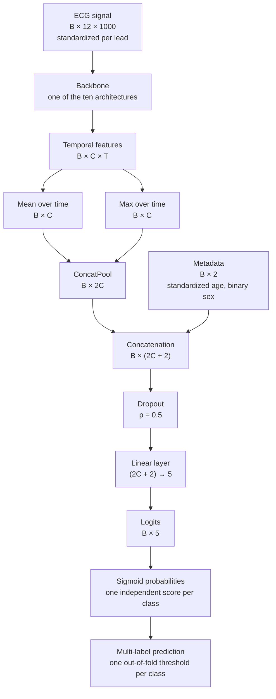

# PTB-XL ECG Cardiac Condition Detection

Multi-label detection of cardiac conditions from 12-lead electrocardiograms using the PTB-XL dataset.

This project compares ten deep learning architectures that represent different ways of modelling an ECG, under one shared, deterministic and fully tracked training protocol. The selected architecture is then used to study five data augmentation methods, with explainable AI as the final stage.

> **Research use only.** This is a research and scientific project. It is not a medical device, has not been clinically validated and must not be used for medical diagnosis or treatment decisions.

## Table of Contents

- [Project Overview](#project-overview)
- [Dataset](#dataset)
- [Data Setup](#data-setup)
- [Repository Structure](#repository-structure)
- [Notebooks](#notebooks)
- [Data Preparation](#data-preparation)
- [Architectures](#architectures)
- [Training Protocol](#training-protocol)
- [Evaluation](#evaluation)
- [Determinism and Reproducibility](#determinism-and-reproducibility)
- [Experiment Tracking and Model Registry](#experiment-tracking-and-model-registry)
- [Architecture Results](#architecture-results)
- [Why cnn1d Was Selected for Augmentation](#why-cnn1d-was-selected-for-augmentation)
- [Data Augmentation](#data-augmentation)
- [Explainable AI](#explainable-ai)
- [Getting Started](#getting-started)
- [References](#references)
- [License](#license)

## Project Overview

**Goal.** Predict five diagnostic superclasses from a 10-second, 12-lead ECG together with the patient's age and sex. A single ECG can carry several diagnoses, so this is a multi-label problem.

| Label | Meaning |
|---|---|
| `NORM` | Normal ECG |
| `MI` | Myocardial infarction |
| `STTC` | ST/T change |
| `CD` | Conduction disturbance |
| `HYP` | Hypertrophy |

The project is organised in three stages:

| Stage | Command | Purpose |
|---|---|---|
| 1. Normalization | `./run.sh prepare` | Compute normalization statistics from the training data of each partition |
| 2. Architectures | `./run.sh all` or `./run.sh <architecture>` | Train and evaluate the ten architectures |
| 3. Augmentation | `./run.sh augmentation cnn1d` | Train and evaluate five augmentation methods, one at a time |

Together the architectures and augmentation methods make up 15 complete training pipelines. Each one goes through the same five folds, out-of-fold threshold selection, final model training, test evaluation, confidence intervals and model registration.

## Dataset

[PTB-XL](https://physionet.org/content/ptb-xl/1.0.3/) is a large, publicly available clinical 12-lead ECG dataset hosted on PhysioNet. It is one of the most widely used benchmarks in ECG deep learning research, which makes results directly comparable to a large body of published work.

| Property | Value |
|---|---|
| Version | 1.0.3 |
| DOI | [10.13026/kfzx-aw45](https://doi.org/10.13026/kfzx-aw45) |
| License | CC BY 4.0 |
| Records | 21,799 |
| Patients | 18,869 |
| Duration | 10 seconds per record |
| Leads | 12 (I, II, III, aVR, aVL, aVF, V1–V6) |
| Sampling rates | 100 Hz and 500 Hz |
| Unit | Millivolts |
| Statements | 71 SCP-ECG statements (diagnostic, form and rhythm) |
| Label hierarchy | 44 diagnostic statements → 23 subclasses → 5 superclasses |
| Likelihood | Each statement has a likelihood between 0 and 100 |
| Metadata | Age, sex, device, site, signal quality notes and human validation status |

This project uses the 100 Hz signals (12 × 1000 samples per record) and the five diagnostic superclasses.

## Data Setup

The `data/` folder is not fully included in the repository. Only the JSON files generated in `data/processed/` are tracked. Download the dataset from the **Files** section of the [dataset page](https://physionet.org/content/ptb-xl/1.0.3/) and place its contents in `data/raw/`, so that `records100/`, `records500/` and all other files sit directly inside `data/raw/`. Nothing should be moved or renamed.

The download is a single flat folder of about 3.2 GB uncompressed:

| Item | Size | Content |
|---|---|---|
| `records100/` | 536 MB | 100 Hz signals in WFDB format (`.dat` and `.hea` per record) |
| `records500/` | 2.6 GB | 500 Hz signals in WFDB format (`.dat` and `.hea` per record) |
| `ptbxl_database.csv` | 6.3 MB | One row per ECG: metadata, `scp_codes`, `strat_fold` and file paths |
| `scp_statements.csv` | 9.5 KB | SCP-ECG statements and their diagnostic superclasses |
| `RECORDS` | 1.1 MB | List of all record paths |
| `SHA256SUMS.txt` | 7.9 MB | Checksums for integrity verification |
| `LICENSE.txt` | 14.5 KB | Dataset license |
| `example_physionet.py` | 1.3 KB | Loading example shipped with the dataset |
| `ptbxl_v102_changelog.txt` | 6.0 KB | Release notes |
| `ptbxl_v103_changelog.txt` | 7.2 KB | Release notes |

The resulting layout is:

```text
data/
├── raw/                            dataset exactly as downloaded (not tracked)
│   ├── records100/
│   ├── records500/
│   ├── example_physionet.py
│   ├── LICENSE.txt
│   ├── ptbxl_database.csv
│   ├── ptbxl_v102_changelog.txt
│   ├── ptbxl_v103_changelog.txt
│   ├── RECORDS
│   ├── scp_statements.csv
│   └── SHA256SUMS.txt
└── processed/                      generated from raw/
    ├── cohort_records.parquet      records, labels and metadata (not tracked)
    ├── cohort_signals_100hz.npy    signal array of the cohort (not tracked)
    ├── normalization_stats.json    normalization statistics of every partition
    ├── preprocessing_report.json   cohort, exclusion and duplicate report
    ├── split_folds.json            test set and fold assignment
    └── split_report.json           split quality report
```

`raw/` stays untouched because the paths in `ptbxl_database.csv`, `RECORDS` and `SHA256SUMS.txt` are relative to the folder that holds `records100/` and `records500/`. `processed/` holds everything generated from `raw/`.

## Repository Structure

```text
.
├── data/                           dataset and generated data
├── mlflow/                         experiment store with all runs, models and checkpoints
│   ├── mlflow.db                   tracking and registry database
│   ├── artifacts/                  run artifacts and logged models
│   ├── models/runs/                fold and final checkpoints per run
│   ├── models/registry/            checkpoint of each registered version
│   └── reports/architectures/      architecture reports as JSON
├── notebooks/
│   ├── 01_exploratory_data_analysis.ipynb
│   ├── 02_preprocessing.ipynb
│   ├── 03_data_split.ipynb
│   └── 04_explainable_ai.ipynb
├── src/
│   ├── architectures/
│   │   ├── __init__.py             architecture registry and factory
│   │   ├── base.py                 shared classifier, pooling and convolution block
│   │   ├── convolutional.py        cnn1d, fcn, resnet1d, xresnet1d, se_resnet1d, inception1d
│   │   ├── temporal.py             tcn
│   │   ├── recurrent.py            cnn_bilstm
│   │   ├── attention.py            transformer1d
│   │   └── state_space.py          s4d
│   ├── augmentations.py            augmentation methods, registry and factory
│   ├── config.py                   paths, constants, training config and runtime setup
│   ├── data.py                     records, split plan, normalization and batching
│   ├── metrics.py                  scores, threshold search and patient bootstrap
│   ├── model_info.py               architecture reports
│   ├── plots.py                    run figures
│   ├── tracking.py                 MLflow tracking, checkpoints and registry
│   └── training.py                 training pipeline and command line entry point
├── requirements.txt
├── run.sh                          entry point for all stages
├── LICENSE
└── README.md
```

## Notebooks

| Notebook | Content |
|---|---|
| `01_exploratory_data_analysis.ipynb` | Explores the raw dataset: metadata and missing values, patient structure, age and sex, the SCP statement hierarchy, likelihoods, superclass frequency and co-occurrence, label quality, acquisition devices and sites, signal quality notes, the official folds, waveforms per superclass, power spectra, amplitudes and signal integrity. |
| `02_preprocessing.ipynb` | Builds the cohort: caps anonymized ages, derives multi-label superclass targets and likelihoods, checks signal integrity, applies the exclusion rules, flags conflicting labels, searches for near-duplicate signals, compares filter variants, and writes the signal array, the record table and the preprocessing report. |
| `03_data_split.ipynb` | Builds the test set and the five folds with patient-level iterative stratification, searches over candidate seeds, audits label, device and demographic balance, compares the split with the official folds, and writes the split files. |
| `04_explainable_ai.ipynb` | Explains the `cnn1d__crop` final model on the test set: confirms its full-signal performance and thresholds, compares Saliency, Integrated Gradients and Grad-CAM with a weight randomization check and a deletion test, shows single and multi-label record explanations for all five superclasses, aligns beats to the QRS, and measures relevance by lead and beat segment, the contribution of age and sex, and the difference between detected and missed `HYP` records. |

## Data Preparation

### Cohort

| Step | Records |
|---|---|
| Source records | 21,799 |
| No diagnostic superclass | −411 |
| Younger than 18 | −133 |
| Blocking integrity issue (flat lead) | −1 |
| **Final cohort** | **21,254 records from 18,499 patients** |

- **Age.** Ages anonymized as 300 in the source data are capped at 90. Cohort ages range from 18 to 90, with a median of 62.
- **Sex.** The cohort contains 11,045 male and 10,209 female records.
- **Labels.** A superclass is positive when the record has any of its statements (likelihood threshold 0). The strongest likelihood per superclass is stored, and it defines the `certain` evaluation subset.
- **Label quality.** 30.2% of records have at least one uncertain label (likelihood below 100). 37 records combine `NORM` with `MI`, `STTC` or `HYP`; they are flagged and kept.
- **Validation.** 74.3% of records were validated by a human.
- **Signal quality.** Notes exist for static noise (15.0%), baseline drift (7.4%), extra beats (8.8%), burst noise (2.7%), electrode problems (0.1%) and pacemakers (0.1%). They are kept as flags.
- **Integrity.** No record has non-finite values. The search over the cohort found no near-duplicate pair above a correlation of 0.99.
- **Signals.** High-pass and band-pass filters were compared in the preprocessing notebook. The stored signals are the unfiltered 100 Hz recordings, kept in millivolts as `float32`.

| Superclass | Records | Share of cohort |
|---|---:|---:|
| `NORM` | 9,406 | 44.3% |
| `MI` | 5,466 | 25.7% |
| `STTC` | 5,227 | 24.6% |
| `CD` | 4,874 | 22.9% |
| `HYP` | 2,644 | 12.4% |

### Split

The cohort is split into a 20% test set and five development folds of 16% each.

| Partition | Records | Patients |
|---|---:|---:|
| `test` | 4,250 | 3,699 |
| `fold_0` | 3,401 | 2,955 |
| `fold_1` | 3,401 | 2,982 |
| `fold_2` | 3,402 | 2,956 |
| `fold_3` | 3,400 | 2,948 |
| `fold_4` | 3,400 | 2,959 |

- **No patient leakage.** All records of a patient stay in one partition. The audit reports zero leaking groups.
- **Iterative stratification.** The split balances 20 targets at once: the 5 superclasses, 9 device groups, label uncertainty, 4 age groups and sex.
- **Seed search.** 20 candidate seeds were compared, and seed 45 gave the smallest worst-case share deviation (0.42 percentage points).

### Normalization

`./run.sh prepare` computes statistics for `cv_0` to `cv_4` and `final`, using only the training folds of each partition. Each signal lead is standardized with its own mean and standard deviation, and age with its own mean and standard deviation. Sex stays binary. Statistics are stored with the SHA-256 digests of the split and preprocessing reports, so they can be checked against the data they came from.

## Architectures

### Shared Classifier

Only the backbone changes between architectures. Every model is wrapped in the same classifier, defined in `src/architectures/base.py`, so differences in the results come from the way each backbone represents the signal. `B` is the batch size, `C` the backbone feature channels and `T` the temporal length of the backbone output.



| Component | Role |
|---|---|
| `ConvBnRelu` | Shared building block: `Conv1d` without bias, batch normalization and an optional ReLU. Padding is `same` at stride 1 and `kernel_size // 2` otherwise. Backbones built on it are `cnn1d`, `fcn`, `resnet1d`, `xresnet1d`, `se_resnet1d`, `inception1d` and the encoder of `cnn_bilstm`. |
| `ConcatPool` | Concatenates the temporal mean and maximum of each feature channel. The mean summarizes the whole recording and the maximum keeps the strongest local response. It also gives a fixed-size output for any input length. |
| `EcgClassifier` | Runs the backbone, applies `ConcatPool`, appends age and sex, then applies dropout and a linear layer that outputs 5 logits. |

Each backbone exposes `feature_channels`, which sets the size of the head.

| Architecture | `C` | `T` for 1000 input samples | Head input size |
|---|---:|---:|---:|
| `cnn1d` | 256 | 62 | 514 |
| `fcn` | 128 | 1000 | 258 |
| `resnet1d` | 128 | 1000 | 258 |
| `xresnet1d` | 1024 | 32 | 2050 |
| `se_resnet1d` | 256 | 32 | 514 |
| `inception1d` | 128 | 1000 | 258 |
| `tcn` | 48 | 1000 | 98 |
| `cnn_bilstm` | 256 | 125 | 514 |
| `transformer1d` | 128 | 100 | 258 |
| `s4d` | 256 | 1000 | 514 |

### Backbones

The ten architectures fall into five families in the code. Each one brings a different idea to the same task.

| Family | Architecture | Angle | Reference |
|---|---|---|---|
| Convolutional | `cnn1d` | Plain convolution and pooling hierarchy, used as the reference model | — |
| Convolutional | `fcn` | Fully convolutional, full temporal resolution with no pooling | Wang et al. 2017 |
| Convolutional | `resnet1d` | Residual connections at full temporal resolution | Wang et al. 2017 |
| Convolutional | `xresnet1d` | Deep bottleneck residual network | He et al. 2019; Strodthoff et al. 2021 |
| Convolutional | `se_resnet1d` | Channel attention with squeeze-and-excitation | Hu et al. 2018 |
| Convolutional | `inception1d` | Multi-scale parallel kernels | Fawaz et al. 2020 |
| Temporal | `tcn` | Causal dilated convolution with an exponentially growing receptive field | Bai et al. 2018 |
| Recurrent | `cnn_bilstm` | Convolutional encoder followed by a bidirectional LSTM | Hochreiter & Schmidhuber 1997 |
| Attention | `transformer1d` | Patch embedding and self-attention | Dosovitskiy et al. 2021 |
| State space | `s4d` | Diagonal state space layers for long sequences | Gu et al. 2022 |

Sequence modelling is covered by four distinct mechanisms: recurrence, attention, state space models and dilated convolution.

| Architecture | Configuration | Parameters | Mult-adds |
|---|---|---:|---:|
| `cnn1d` | Channels 32-64-128-256, kernels 7-5-5-3, max pooling after each block | 155,727 | 30.3M |
| `fcn` | Channels 128-256-128, kernels 8-5-3 | 276,751 | 274.4M |
| `resnet1d` | Three residual blocks, channels 64-128-128, kernels 8-5-3 | 510,479 | 506.6M |
| `xresnet1d` | Stem 32-32-64, stages 3-4-6-3, widths 32-64-128-256, kernel 5, expansion 4 | 4,663,311 | 238.1M |
| `se_resnet1d` | Stem 64 with kernel 15, stages 2-2-2-2, widths 32-64-128-256, kernel 7, reduction 16 | 2,230,091 | 106.3M |
| `inception1d` | Depth 6, 32 filters, kernels 39-19-9, bottleneck 32, residual every 3 modules | 474,639 | 471.3M |
| `tcn` | 7 levels of 48 channels, kernel 7, dropout 0.05, receptive field 1,525 samples | 216,159 | 216.1M |
| `cnn_bilstm` | Channels 64-128-128, kernels 7-5-3, 2-layer BiLSTM with 128 units, dropout 0.2 | 758,159 | 120.6M |
| `transformer1d` | Patch 10, dimension 128, 4 heads, 4 layers, feed-forward 512, dropout 0.1 | 822,927 | 90.4M |
| `s4d` | Dimension 256, state 8, 4 layers, dropout 0.1, time step 0.001–0.1 | 553,231 | 531.5M |

Notes:

- `tcn` keeps the temporal block of Bai et al.: weight-normalized causal convolutions, ReLU, dropout and a residual connection. Dilated convolutions are computed as undilated convolutions over the dilation phases. This space-to-batch form gives numerically identical results and keeps deterministic training practical.
- Mult-adds come from the PyTorch flop counter. LSTM layers are counted with `torchinfo`, and the FFT operations of `s4d` are not counted.
- `python -m src.model_info` writes a detailed JSON report for each architecture to `mlflow/reports/architectures/`, including configuration, sizes and every layer.

## Training Protocol

All ten architectures use the same settings.

| Setting | Value |
|---|---|
| Input | 12 × 1000 signal, age and sex |
| Loss | `BCEWithLogitsLoss` |
| Optimizer | AdamW |
| Learning rate | 0.001 |
| Schedule | OneCycleLR over 50 epochs, 30% warm-up |
| Weight decay | 0.01 on convolution, linear and LSTM weights; all other parameters excluded |
| Batch size | 128 |
| Maximum epochs | 50 |
| Early stopping | Patience 15 on validation macro AUROC |
| Gradient clipping | 1.0 |
| Head dropout | 0.5 |
| Mixed precision | Off |
| Seed | 42 |

The pipeline in `src/training.py` runs these steps for every architecture:

1. **Cross-validation.** Train one model per fold, and keep the epoch with the best validation macro AUROC.
2. **Out-of-fold predictions.** Collect the validation predictions of all five folds.
3. **Thresholds.** Choose one threshold per class by maximizing F1 on the out-of-fold predictions, on a grid from 0.05 to 0.95 with a step of 0.01.
4. **Final model.** Train on all five folds for the median best epoch.
5. **Evaluation.** Evaluate the final model on the test set with the out-of-fold thresholds.
6. **Reporting.** Compute confidence intervals, create figures and register the model.

## Evaluation

| Metric | Use |
|---|---|
| Macro AUROC | Main discrimination metric, independent of thresholds |
| Macro AUPRC | Discrimination under class imbalance |
| Macro F1, precision and recall | Performance at the out-of-fold thresholds |
| Per-class metrics | All of the above for each superclass |

Results are reported for four data sections:

| Section | Records | Content |
|---|---:|---|
| `oof` | 17,004 | Out-of-fold predictions |
| `test` | 4,250 | Full test set |
| `test_validated` | 3,139 | Human-validated test records |
| `test_certain` | 2,968 | Test records whose labels all have likelihood 100 |

**Confidence intervals.** 95% intervals come from a patient-level cluster bootstrap with 1,000 replicates and percentile intervals. Patients, not records, are resampled, which respects repeated recordings of the same patient. Each run stores them in `confidence_intervals.json`.

Test AUROC and AUPRC are the primary test metrics. F1, precision and recall depend on the out-of-fold thresholds, which are selected on fold models and applied to the final model, so they are secondary.

## Determinism and Reproducibility

Every training run is deterministic for a given software and hardware environment.

- **Seeds.** Python, NumPy and PyTorch use seed 42, and `PYTHONHASHSEED` is fixed to 42.
- **Model initialization.** Seeds are reset before every model is built, so all folds start from the same weights.
- **Batch order.** Each stream has its own generator, seeded with `42 + fold`. The final model uses `42 + 5`.
- **Deterministic algorithms.** `torch.use_deterministic_algorithms(True)` is enabled, deterministic convolution backends are required, benchmark mode is disabled, TF32 is disabled and `CUBLAS_WORKSPACE_CONFIG` is fixed to `:4096:8`.
- **Mixed precision.** It stays disabled.
- **Augmentation randomness.** Each method has its own seeded generators and does not touch the global random state. Batch order, initial weights and dropout stay the same as in the baseline.
- **Bootstrap.** It uses a fixed seed of 42.
- **Data lineage.** The SHA-256 digests of `split_folds.json` and `preprocessing_report.json` are logged as run parameters and stored in checkpoints.
- **Normalization guard.** Training stops immediately if the normalization file is missing or does not match the current data.
- **Pinned environment.** Python 3.12.13 and the exact package versions in `requirements.txt`.

## Experiment Tracking and Model Registry

The whole project is managed with MLflow, using a SQLite backend at `mlflow/mlflow.db` and a local artifact store. All runs belong to the `ptbxl-superclass` experiment. The complete `mlflow/` folder is included in this repository, so every run, metric, checkpoint and report can be inspected without retraining.

### Tracking

Each pipeline creates one parent run with five fold runs and one final run.

| Item | Content |
|---|---|
| Parameters | Architecture, training and augmentation settings, and data lineage digests |
| Tags | Stage, fold, model family, augmentation, and checkpoint path and SHA-256 |
| Epoch metrics | Train and validation loss, macro AUROC, AUPRC, F1, precision and recall, plus per-class scores |
| Summary metrics | Best epoch, CV mean and standard deviation, final epoch, out-of-fold thresholds, and all out-of-fold and test scores |
| Figures | `roc_curve.png`, `confusion_matrix.png` and `loss_curve.png` |
| Reports | `confidence_intervals.json` |

Augmented runs are named `<architecture>__<augmentation>`, for example `cnn1d__mixup`, and keep their own checkpoint folder.

### Model Registry

Each final model is registered as `ptbxl-superclass-<architecture>` or `ptbxl-superclass-<architecture>-<augmentation>`, and receives the `candidate` alias.

- **Model format.** Models are logged in the `pt2` format with an input example and a tensor signature for signals and metadata.
- **Environments.** Each model stores pinned `conda.yaml`, `python_env.yaml` and pip requirements.
- **Checkpoints.** Every version is linked to a checkpoint with its path and SHA-256 digest. Checkpoints contain the weights, architecture configuration, normalization statistics, thresholds, class names, data lineage and augmentation name.

Open the interface from the project root:

```bash
mlflow ui --backend-store-uri "sqlite:///$PWD/mlflow/mlflow.db" --port 5000
```

Then visit `http://127.0.0.1:5000`.

## Architecture Results

Values in parentheses are 95% confidence intervals. Each table is sorted by macro AUROC, from highest to lowest. F1, precision and recall use out-of-fold thresholds.

### Out-of-Fold Results

| Architecture | Macro AUROC | Macro AUPRC | Macro F1 | Macro precision | Macro recall |
|---|---|---|---|---|---|
| `inception1d` | 0.9323 (0.9299–0.9347) | 0.8339 (0.8283–0.8398) | 0.7567 (0.7514–0.7624) | 0.7415 (0.7351–0.7479) | 0.7741 (0.7676–0.7805) |
| `cnn_bilstm` | 0.9320 (0.9298–0.9343) | 0.8350 (0.8297–0.8408) | 0.7565 (0.7508–0.7622) | 0.7373 (0.7303–0.7436) | 0.7788 (0.7725–0.7854) |
| `resnet1d` | 0.9314 (0.9288–0.9339) | 0.8313 (0.8254–0.8373) | 0.7578 (0.7522–0.7636) | 0.7458 (0.7390–0.7520) | 0.7713 (0.7648–0.7785) |
| `cnn1d` | 0.9291 (0.9267–0.9317) | 0.8279 (0.8221–0.8338) | 0.7514 (0.7458–0.7570) | 0.7425 (0.7361–0.7489) | 0.7634 (0.7565–0.7698) |
| `fcn` | 0.9284 (0.9258–0.9310) | 0.8292 (0.8231–0.8352) | 0.7554 (0.7497–0.7611) | 0.7463 (0.7397–0.7524) | 0.7659 (0.7593–0.7727) |
| `tcn` | 0.9246 (0.9220–0.9272) | 0.8206 (0.8147–0.8266) | 0.7482 (0.7427–0.7538) | 0.7414 (0.7346–0.7480) | 0.7579 (0.7512–0.7640) |
| `xresnet1d` | 0.9232 (0.9207–0.9258) | 0.8156 (0.8093–0.8220) | 0.7417 (0.7362–0.7473) | 0.7210 (0.7146–0.7272) | 0.7641 (0.7575–0.7707) |
| `s4d` | 0.9173 (0.9147–0.9199) | 0.7969 (0.7900–0.8035) | 0.7263 (0.7202–0.7317) | 0.7054 (0.6985–0.7118) | 0.7490 (0.7422–0.7553) |
| `transformer1d` | 0.9134 (0.9105–0.9162) | 0.7975 (0.7907–0.8037) | 0.7287 (0.7230–0.7345) | 0.7207 (0.7141–0.7272) | 0.7405 (0.7336–0.7474) |
| `se_resnet1d` | 0.9096 (0.9068–0.9123) | 0.7889 (0.7822–0.7957) | 0.7217 (0.7159–0.7277) | 0.7102 (0.7032–0.7170) | 0.7356 (0.7285–0.7424) |

### Test Results

| Architecture | Macro AUROC | Macro AUPRC | Macro F1 | Macro precision | Macro recall |
|---|---|---|---|---|---|
| `resnet1d` | 0.9372 (0.9326–0.9418) | 0.8363 (0.8244–0.8484) | 0.7522 (0.7398–0.7646) | 0.7867 (0.7735–0.8010) | 0.7349 (0.7205–0.7492) |
| `cnn1d` | 0.9360 (0.9316–0.9407) | 0.8368 (0.8253–0.8480) | 0.7346 (0.7210–0.7468) | 0.7884 (0.7754–0.8013) | 0.7013 (0.6865–0.7158) |
| `inception1d` | 0.9356 (0.9313–0.9403) | 0.8323 (0.8209–0.8442) | 0.7364 (0.7268–0.7472) | 0.7168 (0.7059–0.7289) | 0.7951 (0.7835–0.8074) |
| `cnn_bilstm` | 0.9351 (0.9305–0.9400) | 0.8335 (0.8221–0.8456) | 0.7432 (0.7310–0.7550) | 0.7569 (0.7437–0.7701) | 0.7577 (0.7440–0.7716) |
| `fcn` | 0.9324 (0.9275–0.9372) | 0.8325 (0.8203–0.8446) | 0.7528 (0.7416–0.7648) | 0.7589 (0.7449–0.7731) | 0.7583 (0.7453–0.7723) |
| `xresnet1d` | 0.9310 (0.9260–0.9359) | 0.8286 (0.8167–0.8404) | 0.7425 (0.7326–0.7533) | 0.6975 (0.6858–0.7090) | 0.8041 (0.7920–0.8172) |
| `tcn` | 0.9279 (0.9228–0.9330) | 0.8238 (0.8108–0.8360) | 0.7493 (0.7360–0.7612) | 0.7690 (0.7554–0.7820) | 0.7403 (0.7255–0.7550) |
| `s4d` | 0.9212 (0.9161–0.9265) | 0.8017 (0.7894–0.8147) | 0.7165 (0.7047–0.7291) | 0.7236 (0.7112–0.7372) | 0.7181 (0.7035–0.7332) |
| `se_resnet1d` | 0.9141 (0.9085–0.9197) | 0.7976 (0.7856–0.8101) | 0.6724 (0.6590–0.6863) | 0.7624 (0.7479–0.7764) | 0.6410 (0.6267–0.6566) |
| `transformer1d` | 0.9136 (0.9081–0.9191) | 0.7948 (0.7811–0.8083) | 0.7163 (0.7038–0.7284) | 0.6958 (0.6819–0.7093) | 0.7411 (0.7266–0.7556) |

### Test Subsets

| Architecture | Validated AUROC | Validated F1 | Certain AUROC | Certain F1 |
|---|---|---|---|---|
| `resnet1d` | 0.9338 (0.9281–0.9390) | 0.7367 (0.7214–0.7510) | 0.9534 (0.9479–0.9588) | 0.7870 (0.7718–0.8012) |
| `cnn1d` | 0.9314 (0.9255–0.9366) | 0.7206 (0.7046–0.7355) | 0.9508 (0.9457–0.9560) | 0.7572 (0.7407–0.7731) |
| `inception1d` | 0.9311 (0.9257–0.9368) | 0.7261 (0.7133–0.7378) | 0.9500 (0.9441–0.9555) | 0.7306 (0.7168–0.7447) |
| `cnn_bilstm` | 0.9306 (0.9250–0.9359) | 0.7262 (0.7116–0.7410) | 0.9519 (0.9463–0.9570) | 0.7518 (0.7355–0.7656) |
| `fcn` | 0.9284 (0.9222–0.9343) | 0.7377 (0.7222–0.7515) | 0.9461 (0.9396–0.9524) | 0.7829 (0.7679–0.7966) |
| `xresnet1d` | 0.9263 (0.9205–0.9320) | 0.7272 (0.7144–0.7397) | 0.9492 (0.9433–0.9542) | 0.7457 (0.7302–0.7594) |
| `tcn` | 0.9248 (0.9181–0.9309) | 0.7326 (0.7174–0.7465) | 0.9476 (0.9416–0.9533) | 0.7775 (0.7605–0.7912) |
| `s4d` | 0.9152 (0.9088–0.9209) | 0.6978 (0.6833–0.7120) | 0.9402 (0.9342–0.9462) | 0.7379 (0.7218–0.7532) |
| `se_resnet1d` | 0.9113 (0.9048–0.9180) | 0.6504 (0.6345–0.6659) | 0.9355 (0.9287–0.9416) | 0.7185 (0.7006–0.7339) |
| `transformer1d` | 0.9090 (0.9019–0.9153) | 0.7074 (0.6924–0.7214) | 0.9321 (0.9254–0.9385) | 0.7277 (0.7113–0.7432) |

### Per-Class Test Results

| Architecture | AUROC NORM | AUROC MI | AUROC STTC | AUROC CD | AUROC HYP | F1 NORM | F1 MI | F1 STTC | F1 CD | F1 HYP |
|---|---:|---:|---:|---:|---:|---:|---:|---:|---:|---:|
| `resnet1d` | 0.959 | 0.947 | 0.934 | 0.932 | 0.914 | 0.869 | 0.790 | 0.751 | 0.779 | 0.572 |
| `cnn1d` | 0.956 | 0.941 | 0.930 | 0.932 | 0.920 | 0.864 | 0.765 | 0.690 | 0.755 | 0.599 |
| `inception1d` | 0.957 | 0.938 | 0.937 | 0.929 | 0.917 | 0.868 | 0.749 | 0.760 | 0.722 | 0.583 |
| `cnn_bilstm` | 0.954 | 0.937 | 0.938 | 0.928 | 0.919 | 0.871 | 0.725 | 0.770 | 0.731 | 0.618 |
| `fcn` | 0.953 | 0.949 | 0.929 | 0.917 | 0.914 | 0.861 | 0.801 | 0.760 | 0.760 | 0.582 |
| `xresnet1d` | 0.954 | 0.928 | 0.934 | 0.925 | 0.914 | 0.865 | 0.756 | 0.753 | 0.766 | 0.574 |
| `tcn` | 0.958 | 0.939 | 0.931 | 0.911 | 0.901 | 0.874 | 0.768 | 0.770 | 0.737 | 0.598 |
| `s4d` | 0.948 | 0.923 | 0.920 | 0.918 | 0.897 | 0.847 | 0.732 | 0.705 | 0.744 | 0.555 |
| `se_resnet1d` | 0.936 | 0.910 | 0.905 | 0.915 | 0.905 | 0.832 | 0.527 | 0.652 | 0.744 | 0.607 |
| `transformer1d` | 0.942 | 0.917 | 0.915 | 0.895 | 0.898 | 0.846 | 0.726 | 0.715 | 0.712 | 0.582 |

### Out-of-Fold Thresholds

| Architecture | NORM | MI | STTC | CD | HYP |
|---|---:|---:|---:|---:|---:|
| `cnn1d` | 0.42 | 0.40 | 0.43 | 0.52 | 0.35 |
| `fcn` | 0.44 | 0.40 | 0.37 | 0.33 | 0.32 |
| `resnet1d` | 0.47 | 0.32 | 0.42 | 0.42 | 0.31 |
| `xresnet1d` | 0.33 | 0.38 | 0.47 | 0.29 | 0.39 |
| `se_resnet1d` | 0.29 | 0.43 | 0.49 | 0.47 | 0.41 |
| `inception1d` | 0.34 | 0.48 | 0.36 | 0.42 | 0.36 |
| `tcn` | 0.43 | 0.39 | 0.38 | 0.38 | 0.29 |
| `cnn_bilstm` | 0.49 | 0.28 | 0.33 | 0.38 | 0.45 |
| `transformer1d` | 0.60 | 0.35 | 0.35 | 0.39 | 0.35 |
| `s4d` | 0.51 | 0.38 | 0.46 | 0.30 | 0.33 |

### Key Findings

- **The top group is tight.** `resnet1d`, `cnn1d`, `inception1d` and `cnn_bilstm` are within 0.0021 of each other in test macro AUROC.
- **Simple models compete.** The compact `cnn1d` matches the larger convolutional and hybrid models on test AUROC and AUPRC. This agrees with published PTB-XL benchmarks, where complex architectures show limited gains over simple ones.
- **`HYP` is the hardest class.** It has the lowest out-of-fold F1 in all ten architectures and the lowest out-of-fold AUROC in six of them. It is the rarest class, and many of its labels are uncertain: in the test set, 46% of `HYP` positives have a likelihood below 100.
- **Label certainty matters.** Macro AUROC rises by 0.014–0.021 on the `test_certain` subset compared with the full test set.

### Comparison With the Literature

The benchmark of Strodthoff et al. reports results for the same five superclasses on human-validated test records. The closest section in this project is `test_validated`.

| Model | Strodthoff et al. macro AUC | This project (`test_validated`) |
|---|---:|---:|
| `resnet1d_wang` / `resnet1d` | 0.930 | 0.9338 |
| `xresnet1d101` / `xresnet1d` | 0.928 | 0.9263 |
| `fcn_wang` / `fcn` | 0.925 | 0.9284 |
| `inception1d` / `inception1d` | 0.921 | 0.9311 |

Results are in the same range. A direct ranking is not possible because the split, input length and use of age and sex differ.

## Why cnn1d Was Selected for Augmentation

The augmentation study needs a model that is competitive, cheap to retrain and has room to benefit from regularization. Paired patient-level bootstrap differences on the out-of-fold predictions (1,000 replicates, `cnn1d` minus the other model):

| Compared with | Macro AUROC difference | `HYP` AUPRC difference |
|---|---|---|
| `inception1d` | −0.0031 (−0.0046 to −0.0017) | −0.0014 (−0.0122 to 0.0084) |
| `cnn_bilstm` | −0.0029 (−0.0043 to −0.0014) | −0.0030 (−0.0123 to 0.0064) |
| `resnet1d` | −0.0022 (−0.0036 to −0.0009) | +0.0099 (0.0005 to 0.0194) |

| Criterion | `cnn1d` | `inception1d` | `cnn_bilstm` | `resnet1d` |
|---|---:|---:|---:|---:|
| OOF macro AUROC | 0.9291 | 0.9323 | 0.9320 | 0.9314 |
| OOF `HYP` AUPRC | 0.7053 | 0.7070 | 0.7080 | 0.6950 |
| Train macro AUROC | 0.9664 | 0.9581 | 0.9581 | 0.9555 |
| Train–OOF gap | 0.0373 | 0.0258 | 0.0261 | 0.0241 |
| Parameters | 155,727 | 474,639 | 758,159 | 510,479 |
| Training time | 6.8 min | 95.5 min | 27.1 min | 84.3 min |

- **Competitive.** `cnn1d` is within 0.0031 of the best models in out-of-fold macro AUROC. On `HYP` AUPRC it cannot be distinguished from `inception1d` and `cnn_bilstm`, and it is higher than `resnet1d`.
- **Fast.** It is the fastest of the top four, by a factor of 4 to 14.
- **Room to improve.** It has the largest train–out-of-fold gap of the top four, so it has the most to gain from augmentation.
- **Interpretable.** A single, compact model keeps the explainable AI stage clear, and it accepts the full 1000-sample signal regardless of the training window.

No ensemble is used, so each result comes from one final model.

## Data Augmentation

`src/augmentations.py` is architecture-independent. Methods live in a registry, as the architectures do, and the architecture is only a command line parameter. Each method is compared with the baseline on its own and goes through the complete pipeline.

### Five Angles

| Method | Angle | What the model should learn |
|---|---|---|
| `crop` | Temporal position | A diagnosis does not depend on where a segment sits in the recording |
| `mixup` | Global mixing between records | Decision boundaries between classes should be smooth |
| `cutmix` | Local mixing between records | The label should follow the content of the signal |
| `rotation` | Spatial and physiological | The orientation of the heart in the chest does not change the diagnosis |
| `time_mask` | Missing information within a record | The model should not depend on a single beat |

### Settings

| Method | Setting | Probability | Basis |
|---|---|---|---|
| `crop` | 250-sample window (2.5 s); test-time augmentation with stride 125 (7 windows), aggregated by maximum | Every record | Strodthoff et al. 2021; Nonaka & Seita 2021; Mehari & Strodthoff 2022 |
| `mixup` | α = 0.4; signal, metadata and labels share the same weight | 0.5 | Guo et al. 2023 |
| `cutmix` | 200-sample segment (20%), same interval on all leads, labels mixed by area | 0.5 | Guo et al. 2023 |
| `rotation` | Up to ±10° per axis in vectorcardiogram space | 0.5 | Gopal et al. 2021 |
| `time_mask` | 100-sample segment (10%), same interval on all leads, set to 0 | 0.5 | Raghu et al. 2022 |

The settings were also checked against the training data. The median RR interval is 0.84 s, so a 2.5 s window contains a median of 3 beats, and a 2 s segment almost always contains at least one. `time_mask` removes about one of roughly twelve beats. The ±10° limit is well below the estimated 41–47° within-class spread of the QRS axis, and below the estimated 30° difference between `NORM` and `MI`.

Amplitude scaling, signal inversion, time warping, permutation and SMOTE were excluded. Amplitude and polarity carry diagnostic meaning, voltage in particular for `HYP`, and SMOTE performed worst for `HYP` in Raghu et al. 2022.

### Implementation Details

- **`rotation`.** Normalization is reversed, the leads are projected to a vectorcardiogram with the inverse Dower transform, and only the difference caused by the rotation is added back to the 12 leads. The part of the signal outside the three-dimensional model is preserved, and limb lead relations stay intact.
- **`crop`.** Validation, out-of-fold, final training and test predictions use all 7 windows, so thresholds come from the same inference procedure.
- **`mixup` and `cutmix`.** The loss uses mixed labels. Training metrics use unmixed records with their original labels.
- **Reproducibility.** See [Determinism and Reproducibility](#determinism-and-reproducibility).
- **Compatibility.** `crop` requires a model that accepts variable input length, so `transformer1d` stops with a clear error.

### Augmentation Results

Baseline values are repeated from [Architecture Results](#architecture-results). Values in parentheses are 95% confidence intervals. After the baseline row, each table is sorted by macro AUROC, from highest to lowest. F1, precision and recall use the out-of-fold thresholds of each run. Decisions are based on out-of-fold macro AUROC and out-of-fold `HYP` AUPRC.

#### Out-of-Fold Results

| Run | Macro AUROC | Macro AUPRC | Macro F1 | `HYP` AUROC | `HYP` AUPRC | `HYP` F1 | `HYP` recall |
|---|---|---|---|---|---|---|---|
| `cnn1d` baseline | 0.9291 (0.9267–0.9317) | 0.8279 (0.8221–0.8338) | 0.7514 (0.7458–0.7570) | 0.9168 (0.9099–0.9227) | 0.7053 (0.6848–0.7241) | 0.6339 (0.6158–0.6512) | 0.6515 (0.6311–0.6709) |
| `cnn1d__crop` | 0.9376 (0.9352–0.9398) | 0.8450 (0.8392–0.8502) | 0.7674 (0.7621–0.7726) | 0.9213 (0.9146–0.9271) | 0.7174 (0.6970–0.7352) | 0.6435 (0.6263–0.6602) | 0.6648 (0.6433–0.6848) |
| `cnn1d__mixup` | 0.9330 (0.9307–0.9353) | 0.8343 (0.8282–0.8404) | 0.7608 (0.7552–0.7665) | 0.9133 (0.9062–0.9196) | 0.6982 (0.6762–0.7169) | 0.6346 (0.6153–0.6523) | 0.6113 (0.5900–0.6322) |
| `cnn1d__cutmix` | 0.9328 (0.9304–0.9351) | 0.8340 (0.8286–0.8399) | 0.7594 (0.7541–0.7647) | 0.9152 (0.9082–0.9214) | 0.7070 (0.6872–0.7256) | 0.6350 (0.6162–0.6526) | 0.6582 (0.6365–0.6781) |
| `cnn1d__rotation` | 0.9315 (0.9291–0.9338) | 0.8310 (0.8252–0.8366) | 0.7561 (0.7508–0.7615) | 0.9166 (0.9098–0.9226) | 0.6991 (0.6779–0.7181) | 0.6365 (0.6180–0.6529) | 0.6279 (0.6063–0.6492) |
| `cnn1d__time_mask` | 0.9307 (0.9282–0.9332) | 0.8319 (0.8261–0.8378) | 0.7580 (0.7525–0.7635) | 0.9181 (0.9111–0.9243) | 0.7118 (0.6908–0.7305) | 0.6444 (0.6257–0.6614) | 0.6662 (0.6456–0.6876) |

#### Test Results

| Run | Macro AUROC | Macro AUPRC | Macro F1 | `HYP` AUROC | `HYP` AUPRC | `HYP` F1 | `HYP` recall |
|---|---|---|---|---|---|---|---|
| `cnn1d` baseline | 0.9360 (0.9316–0.9407) | 0.8368 (0.8253–0.8480) | 0.7346 (0.7210–0.7468) | 0.9205 (0.9091–0.9321) | 0.6992 (0.6612–0.7392) | 0.5986 (0.5594–0.6382) | 0.5766 (0.5312–0.6207) |
| `cnn1d__crop` | 0.9412 (0.9371–0.9456) | 0.8466 (0.8353–0.8577) | 0.7704 (0.7593–0.7816) | 0.9249 (0.9137–0.9363) | 0.7111 (0.6719–0.7510) | 0.6380 (0.5996–0.6762) | 0.6314 (0.5873–0.6791) |
| `cnn1d__mixup` | 0.9375 (0.9329–0.9424) | 0.8384 (0.8265–0.8500) | 0.7602 (0.7484–0.7719) | 0.9135 (0.9001–0.9264) | 0.6906 (0.6491–0.7302) | 0.6187 (0.5788–0.6560) | 0.5766 (0.5295–0.6201) |
| `cnn1d__cutmix` | 0.9373 (0.9329–0.9419) | 0.8389 (0.8273–0.8504) | 0.7522 (0.7400–0.7641) | 0.9169 (0.9052–0.9286) | 0.6957 (0.6565–0.7359) | 0.5906 (0.5466–0.6334) | 0.4991 (0.4524–0.5450) |
| `cnn1d__rotation` | 0.9371 (0.9328–0.9415) | 0.8397 (0.8286–0.8509) | 0.7387 (0.7264–0.7513) | 0.9162 (0.9039–0.9284) | 0.7030 (0.6617–0.7412) | 0.5910 (0.5478–0.6305) | 0.4820 (0.4363–0.5249) |
| `cnn1d__time_mask` | 0.9368 (0.9324–0.9414) | 0.8370 (0.8251–0.8489) | 0.7436 (0.7317–0.7555) | 0.9193 (0.9075–0.9311) | 0.6931 (0.6531–0.7328) | 0.5983 (0.5598–0.6380) | 0.6011 (0.5584–0.6433) |

#### Test Subsets

| Run | Validated AUROC | Validated F1 | Certain AUROC | Certain F1 |
|---|---|---|---|---|
| `cnn1d` baseline | 0.9314 (0.9255–0.9366) | 0.7206 (0.7046–0.7355) | 0.9508 (0.9457–0.9560) | 0.7572 (0.7407–0.7731) |
| `cnn1d__crop` | 0.9371 (0.9318–0.9421) | 0.7603 (0.7474–0.7736) | 0.9550 (0.9496–0.9601) | 0.7887 (0.7742–0.8027) |
| `cnn1d__mixup` | 0.9336 (0.9281–0.9389) | 0.7452 (0.7310–0.7585) | 0.9502 (0.9446–0.9557) | 0.7805 (0.7648–0.7947) |
| `cnn1d__cutmix` | 0.9325 (0.9270–0.9378) | 0.7338 (0.7191–0.7476) | 0.9527 (0.9475–0.9579) | 0.7929 (0.7770–0.8073) |
| `cnn1d__rotation` | 0.9317 (0.9260–0.9368) | 0.7168 (0.7015–0.7325) | 0.9527 (0.9474–0.9579) | 0.7971 (0.7823–0.8116) |
| `cnn1d__time_mask` | 0.9324 (0.9269–0.9376) | 0.7284 (0.7141–0.7440) | 0.9518 (0.9466–0.9571) | 0.7729 (0.7584–0.7873) |

#### Per-Class Test Results

| Run | AUROC NORM | AUROC MI | AUROC STTC | AUROC CD | AUROC HYP | F1 NORM | F1 MI | F1 STTC | F1 CD | F1 HYP |
|---|---:|---:|---:|---:|---:|---:|---:|---:|---:|---:|
| `cnn1d` baseline | 0.956 | 0.941 | 0.930 | 0.932 | 0.920 | 0.864 | 0.765 | 0.690 | 0.755 | 0.599 |
| `cnn1d__crop` | 0.959 | 0.948 | 0.937 | 0.937 | 0.925 | 0.881 | 0.794 | 0.761 | 0.778 | 0.638 |
| `cnn1d__mixup` | 0.958 | 0.947 | 0.935 | 0.934 | 0.913 | 0.875 | 0.789 | 0.750 | 0.768 | 0.619 |
| `cnn1d__cutmix` | 0.957 | 0.944 | 0.937 | 0.932 | 0.917 | 0.875 | 0.770 | 0.764 | 0.761 | 0.591 |
| `cnn1d__rotation` | 0.957 | 0.941 | 0.936 | 0.936 | 0.916 | 0.872 | 0.697 | 0.761 | 0.773 | 0.591 |
| `cnn1d__time_mask` | 0.956 | 0.942 | 0.933 | 0.934 | 0.919 | 0.870 | 0.757 | 0.745 | 0.748 | 0.598 |

#### Out-of-Fold Thresholds

| Run | NORM | MI | STTC | CD | HYP |
|---|---:|---:|---:|---:|---:|
| `cnn1d` baseline | 0.42 | 0.40 | 0.43 | 0.52 | 0.35 |
| `cnn1d__crop` | 0.69 | 0.56 | 0.55 | 0.64 | 0.46 |
| `cnn1d__mixup` | 0.52 | 0.39 | 0.33 | 0.33 | 0.35 |
| `cnn1d__cutmix` | 0.49 | 0.35 | 0.45 | 0.31 | 0.33 |
| `cnn1d__rotation` | 0.47 | 0.46 | 0.37 | 0.39 | 0.31 |
| `cnn1d__time_mask` | 0.39 | 0.45 | 0.34 | 0.58 | 0.30 |

`crop` thresholds are higher because taking the maximum over 7 windows raises the predicted probabilities.

#### Training Behaviour

| Run | Best epoch per fold | Final epochs | Train macro AUROC | Train–OOF gap | Mean within-fold macro AUROC | Training time |
|---|---|---:|---:|---:|---:|---:|
| `cnn1d` baseline | 30, 29, 28, 29, 31 | 29 | 0.9664 | 0.0373 | 0.9353 | 6.8 min |
| `cnn1d__crop` | 46, 46, 43, 41, 42 | 43 | 0.9657 | 0.0281 | 0.9379 | 6.4 min |
| `cnn1d__mixup` | 27, 39, 42, 36, 42 | 39 | 0.9705 | 0.0375 | 0.9350 | 9.1 min |
| `cnn1d__cutmix` | 37, 36, 31, 29, 31 | 31 | 0.9624 | 0.0296 | 0.9357 | 8.4 min |
| `cnn1d__rotation` | 22, 34, 29, 31, 33 | 31 | 0.9650 | 0.0335 | 0.9351 | 7.8 min |
| `cnn1d__time_mask` | 22, 29, 31, 29, 33 | 29 | 0.9653 | 0.0346 | 0.9352 | 7.1 min |

#### Paired Comparison With the Baseline

Paired patient-level bootstrap differences (1,000 replicates, method minus baseline), computed from the predictions of the saved checkpoints.

Two out-of-fold views are shown. The pooled view is the metric used in the tables above. It ranks the predictions of five different fold models together, so it also rewards models whose scores stay on the same scale across folds. The within-fold view computes the metric inside each fold and averages the results, so it measures ranking quality only. Ranking the scores inside each fold before pooling reproduces the within-fold macro AUROC of every run to four decimals, which confirms that the difference between the two views comes from score scale.

Macro AUROC:

| Run | Pooled out-of-fold | Within-fold out-of-fold | Test |
|---|---|---|---|
| `cnn1d__crop` | +0.0084 (0.0073 to 0.0096) | +0.0027 (0.0018 to 0.0035) | +0.0053 (0.0034 to 0.0072) |
| `cnn1d__mixup` | +0.0039 (0.0027 to 0.0051) | −0.0002 (−0.0011 to 0.0006) | +0.0015 (−0.0006 to 0.0035) |
| `cnn1d__cutmix` | +0.0036 (0.0024 to 0.0049) | +0.0005 (−0.0004 to 0.0014) | +0.0013 (−0.0007 to 0.0032) |
| `cnn1d__rotation` | +0.0024 (0.0012 to 0.0035) | −0.0002 (−0.0011 to 0.0006) | +0.0012 (−0.0007 to 0.0030) |
| `cnn1d__time_mask` | +0.0015 (0.0005 to 0.0025) | 0.0000 (−0.0007 to 0.0007) | +0.0008 (−0.0001 to 0.0017) |

`HYP` AUPRC:

| Run | Pooled out-of-fold | Within-fold out-of-fold | Test |
|---|---|---|---|
| `cnn1d__crop` | +0.0121 (0.0042 to 0.0196) | +0.0041 (−0.0028 to 0.0105) | +0.0119 (−0.0021 to 0.0261) |
| `cnn1d__mixup` | −0.0070 (−0.0162 to 0.0009) | −0.0111 (−0.0183 to −0.0043) | −0.0086 (−0.0244 to 0.0064) |
| `cnn1d__cutmix` | +0.0017 (−0.0064 to 0.0100) | +0.0035 (−0.0033 to 0.0106) | −0.0036 (−0.0173 to 0.0099) |
| `cnn1d__rotation` | −0.0062 (−0.0140 to 0.0019) | +0.0005 (−0.0051 to 0.0065) | +0.0037 (−0.0097 to 0.0190) |
| `cnn1d__time_mask` | +0.0065 (−0.0002 to 0.0134) | +0.0034 (−0.0016 to 0.0085) | −0.0061 (−0.0143 to 0.0017) |

All `crop` intervals that exclude zero, and the within-fold `mixup` `HYP` AUPRC interval, still exclude zero after a Bonferroni correction for ten comparisons (five methods, two decision metrics).

#### Training and Inference Effects of `crop`

The `crop` run combines random cropping in training with 7-window prediction. Both effects were separated afterwards by predicting with the saved checkpoints, without any new training. Thresholds were fitted on the out-of-fold predictions of the same inference procedure.

| Model | Inference | OOF macro AUROC | Test macro AUROC | Test macro AUPRC | Test macro F1 |
|---|---|---:|---:|---:|---:|
| `cnn1d` baseline | Full signal | 0.9291 | 0.9360 | 0.8368 | 0.7346 |
| `cnn1d` baseline | 7 windows | 0.9235 | 0.9292 | 0.8226 | 0.7328 |
| `cnn1d__crop` | 7 windows (reported run) | 0.9376 | 0.9412 | 0.8466 | 0.7704 |
| `cnn1d__crop` | Full signal | 0.9391 | 0.9430 | 0.8509 | 0.7744 |

#### Key Findings

- **`crop` has the best result on both decision metrics.** It is also the only method that beats the baseline on macro AUROC in all three views. Its test macro AUROC of 0.9412 is the highest of the 15 runs, above `resnet1d` by 0.0041 (0.0017 to 0.0065) and `inception1d` by 0.0056 (0.0032 to 0.0080).
- **The gain comes from training on crops.** On the test set, the crop-trained model with full-signal inference beats the baseline by 0.0070 (0.0053 to 0.0088). The 7-window maximum lowers its macro AUROC by 0.0018 (0.0009 to 0.0026) and lowers the baseline model's by 0.0068 (0.0053 to 0.0080). Out-of-fold results agree. Full-signal inference was evaluated after the runs, so the `crop` tables keep the original 7-window results.
- **The other four methods show no ranking gain.** Their pooled out-of-fold improvements disappear within folds, and none of them differs from the baseline in test macro AUROC.
- **`crop` stabilizes the score scale.** Its pooled and within-fold macro AUROC differ by 0.0003, against 0.0062 for the baseline. Its out-of-fold thresholds therefore transfer well to the final model: test macro F1 rises by 0.0358 (0.0272 to 0.0443), and the test macro precision and recall become balanced at 0.7622 and 0.7804, against 0.7884 and 0.7013 for the baseline. Its best epochs are also the latest, between 41 and 46.
- **F1 changes of the other methods are not ranking gains.** Their test AUROC stays the same while thresholds transfer unevenly to the final model. For example, `HYP` recall falls to 0.4820 with `rotation` and 0.4991 with `cutmix`.
- **`HYP` is not solved by augmentation.** `crop` improves pooled out-of-fold `HYP` AUPRC by 0.0121, but the within-fold and test differences do not exclude zero. `mixup` lowers within-fold `HYP` AUPRC by 0.0111.
- **`mixup` improves probability quality rather than ranking.** It has the lowest binary cross-entropy of the six runs, 0.2613 out-of-fold and 0.2549 on test, against 0.2738 and 0.2762 for the baseline.
- **Regularization differs by method.** The train–out-of-fold gap narrows most with `crop` and `cutmix`, and it does not narrow with `mixup`.

These results come from one seed and from each method applied alone to `cnn1d`. Method combinations were not tested, and the other nine architectures were not augmented, so the comparison with them does not show that `cnn1d` is the best architecture under augmentation.

## Explainable AI

`04_explainable_ai.ipynb` explains the `cnn1d__crop` final model, which has the best test macro AUROC of the 15 runs. The analysis uses the full 1000-sample signal, because training on crops produced the gain and full-signal inference scores higher than the 7-window maximum. On this input the model reaches a test macro AUROC of 0.9430, macro AUPRC of 0.8509 and macro F1 of 0.7744.

These results describe how the model behaves. They are not a clinical validation.

### Setup

| Setting | Value |
|---|---|
| Explained output | Logit of the target superclass |
| Thresholds | Out-of-fold, full-signal: NORM 0.42, MI 0.31, STTC 0.33, CD 0.35, HYP 0.26 |
| Class-level records | The 100 highest-scoring human-validated true positives per superclass in the test set |
| Beat alignment | QRS centre from multi-lead signal energy, window from −300 to +500 ms |
| Beat segments | P-PR (−300 to −60 ms), QRS (−60 to +60 ms), ST-T (+60 to +500 ms) |
| Share calculation | Beats are averaged per record, each record sums to 100%, then records are averaged |

The aligned beats were checked on all test records: the median RR interval from this detector is 0.84 s, the same as the value measured on the training data.

### Attribution Methods

| Method | Resolution | How it works |
|---|---|---|
| Saliency | Sample and lead | Absolute gradient of the logit with respect to the input |
| Integrated Gradients | Sample and lead | Gradients averaged over 64 steps from a flat signal with neutral age and sex, multiplied by the distance from that baseline. Only positive evidence is used for relevance |
| Grad-CAM | Time only, 80 ms feature step | Weighted activations of the last convolution block |

### Method Selection

Two checks decide the primary method. A valid method must change when the weights are randomized, and removing what it marks as relevant must lower the prediction.

**Weight randomization.** Weights are randomized cumulatively. Values are the mean rank similarity with the trained model, so lower is better. A method passes when the similarity with all layers randomized is at most 0.5.

| Method | Head | Head + last block | All layers |
|---|---:|---:|---:|
| Saliency | 0.32 | 0.12 | 0.06 |
| Integrated Gradients | 0.03 | 0.04 | 0.05 |
| Grad-CAM | 0.21 | 0.10 | 0.31 |

**Deletion test.** 160 ms patches per lead are replaced by their mean, most relevant first and least relevant first. The score is the area between the two probability curves up to 50% deletion, so higher is better.

| Method | NORM | MI | STTC | CD | HYP |
|---|---:|---:|---:|---:|---:|
| Integrated Gradients | 0.589 | 0.128 | 0.493 | 0.243 | 0.792 |
| Grad-CAM | 0.335 | 0.067 | 0.197 | 0.139 | 0.462 |
| Saliency | 0.112 | 0.023 | 0.055 | 0.037 | 0.195 |

All three methods pass the randomization check. Integrated Gradients has the highest deletion score for every superclass and is the primary method. Grad-CAM was not a candidate because it cannot separate leads. The mean completeness gap of Integrated Gradients is between 0.016 and 0.027 logits.

### Relevance by Lead

Integrated Gradients, share of relevance (%). The highest value of each row is in bold.

| Superclass | I | II | III | aVR | aVL | aVF | V1 | V2 | V3 | V4 | V5 | V6 |
|---|---:|---:|---:|---:|---:|---:|---:|---:|---:|---:|---:|---:|
| `NORM` | 7.6 | 9.0 | 4.3 | 10.5 | 4.7 | 7.6 | 8.2 | **12.0** | 8.1 | 7.9 | 10.5 | 9.6 |
| `MI` | 8.3 | 6.5 | 6.9 | 6.1 | 6.4 | 10.1 | 12.1 | **13.5** | 9.3 | 7.4 | 7.6 | 5.9 |
| `STTC` | 6.5 | 8.3 | 6.1 | 7.5 | 5.5 | 6.5 | 10.9 | **13.2** | 6.4 | 6.9 | 11.7 | 10.4 |
| `CD` | 6.6 | 7.4 | 10.1 | 8.5 | 7.2 | 8.6 | **20.1** | 9.3 | 5.4 | 4.8 | 6.4 | 5.7 |
| `HYP` | 6.6 | 6.9 | 6.2 | 6.0 | 5.5 | 6.4 | 11.2 | 10.0 | 5.8 | 5.6 | **18.0** | 11.9 |

The strongest single lead and segment pairs are QRS in V1 for `CD` (13.1%), QRS in V5 for `HYP` (12.4%), QRS in V2 for `MI` (7.8%), QRS in V2 for `STTC` (7.4%) and QRS in V2 for `NORM` (6.0%).

With Saliency, V1 and V2 lead in every superclass at 11.0–13.9%, and all other leads stay at 6.1–9.0%. It shows no lead pattern specific to a superclass.

### Relevance by Beat Segment

Share of relevance (%). The last row is the share of the beat window taken by each segment.

| Superclass | IG P-PR | IG QRS | IG ST-T | Saliency P-PR | Saliency QRS | Saliency ST-T |
|---|---:|---:|---:|---:|---:|---:|
| `NORM` | 15.2 | 44.1 | 40.7 | 28.0 | 17.6 | 54.4 |
| `MI` | 13.8 | 59.2 | 27.0 | 34.7 | 22.6 | 42.8 |
| `STTC` | 11.8 | 49.2 | 38.9 | 26.2 | 14.4 | 59.3 |
| `CD` | 13.8 | 55.0 | 31.2 | 36.0 | 17.0 | 47.1 |
| `HYP` | 14.7 | 47.2 | 38.0 | 27.5 | 16.1 | 56.4 |
| Time share | 30.0 | 15.0 | 55.0 | 30.0 | 15.0 | 55.0 |

### Age and Sex

| Superclass | Share of absolute attribution (%) | Mean age attribution (logit) | Mean sex attribution (logit) |
|---|---:|---:|---:|
| `NORM` | 0.47 | +0.161 | +0.010 |
| `MI` | 0.19 | +0.032 | +0.009 |
| `STTC` | 0.16 | +0.054 | +0.001 |
| `CD` | 0.09 | +0.018 | +0.002 |
| `HYP` | 0.10 | +0.034 | 0.000 |

### Detected and Missed `HYP` Records

All records are human-validated. Relevance is computed for the `HYP` output in both groups.

| Measure | Detected | Missed |
|---|---:|---:|
| Records | 100 | 154 |
| Median predicted probability | 0.972 | 0.084 |
| Median `HYP` likelihood | 100 | 50 |
| Records with another superclass | 88.0% | 74.0% |
| Relevance in V5 | 18.0% | 9.2% |
| Relevance in V6 | 11.9% | 7.4% |
| Relevance in QRS | 47.2% | 35.6% |
| Relevance in P-PR | 14.7% | 23.6% |
| Relevance in ST-T | 38.0% | 40.9% |

### Key Findings

- **The model uses different leads for different superclasses.** With Integrated Gradients, `CD` concentrates on V1, `HYP` on V5 and V6, and `MI` on V1, V2 and aVF. These patterns are consistent with the role of V1 in bundle branch block, left precordial voltage in hypertrophy, and anterior and inferior infarction.
- **The QRS complex carries most of the Integrated Gradients relevance.** It holds 44–59% of the relevance in 15% of the beat window, and it is highest for `MI` and `CD`.
- **`STTC` is not explained by ST-T.** Its Integrated Gradients ST-T share of 38.9% is below the `NORM` share of 40.7%, so these results do not show the expected focus on the ST segment and T wave.
- **Missed `HYP` records lack the pattern of detected ones.** V5 relevance falls by half and relevance moves away from the QRS. Their median label likelihood is also 50 against 100, so part of this error comes from uncertain labels.
- **Age and sex have little influence.** They take less than 0.5% of the absolute attribution in every superclass. Age adds the most for `NORM`.
- **`MI` is the hardest to remove.** After 30% deletion, the probability only falls from 0.996 to 0.825 with Integrated Gradients, and it does not fall further at 50%. Its evidence appears to be spread across many beats and leads.

### Limitations

- **The methods disagree.** The superclass patterns appear only with Integrated Gradients. Saliency stays close to uniform across superclasses, and its segment shares stay close to the time shares.
- **Integrated Gradients depends on amplitude.** It multiplies gradients by the distance from a flat signal, so part of its QRS share may come from the size of the QRS itself. The analysis does not separate these two effects.
- **The deletion test can favour methods that mark the QRS.** Replacing a QRS with its mean creates a signal the model never saw, so a fall in probability is not only a measure of diagnostic evidence.
- **Selected records are easy cases.** The 100 records per superclass are the most confident true positives, with a lowest probability of 0.839 for `HYP` and at least 0.966 for the others.
- **Segments are fixed windows.** A wide QRS can extend past +60 ms, so part of the `CD` QRS relevance may fall into ST-T.
- **Values are descriptive.** They have no confidence intervals, and the clinical comparisons have not been reviewed by a cardiologist.

## Getting Started

### Installation

Python 3.12.13 is required.

```bash
git clone <repository-url>
cd ptbxl-ecg-cardiac-condition-detection
python -m venv .venv
source .venv/bin/activate
pip install -r requirements.txt
```

### Reproducing the Project

1. Download the dataset into `data/raw/` as described in [Data Setup](#data-setup).
2. Run the first three notebooks in order from the `notebooks/` folder. `02_preprocessing.ipynb` creates the signal array and record table, and `03_data_split.ipynb` creates the split files.
3. Compute the normalization statistics. Training does not run without them.

   ```bash
   ./run.sh prepare
   ```

4. Train the architectures.

   ```bash
   ./run.sh all            # all ten architectures
   ./run.sh cnn1d          # one architecture
   ```

5. Train the augmentation runs.

   ```bash
   ./run.sh augmentation cnn1d          # all five methods, one after another
   ./run.sh augmentation cnn1d mixup    # one method
   ```

6. Generate the architecture reports.

   ```bash
   python -m src.model_info
   ```

Architectures: `cnn1d`, `fcn`, `resnet1d`, `xresnet1d`, `se_resnet1d`, `inception1d`, `tcn`, `cnn_bilstm`, `transformer1d`, `s4d`.

Augmentations: `crop`, `mixup`, `cutmix`, `rotation`, `time_mask`.

## License

The code is released under the [MIT License](LICENSE). The PTB-XL dataset is distributed by PhysioNet under the CC BY 4.0 license.
